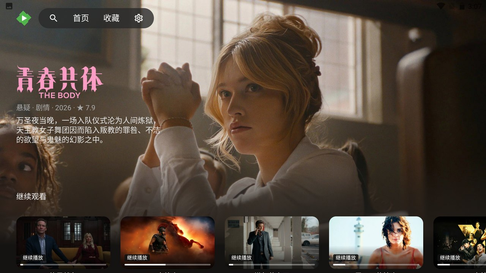
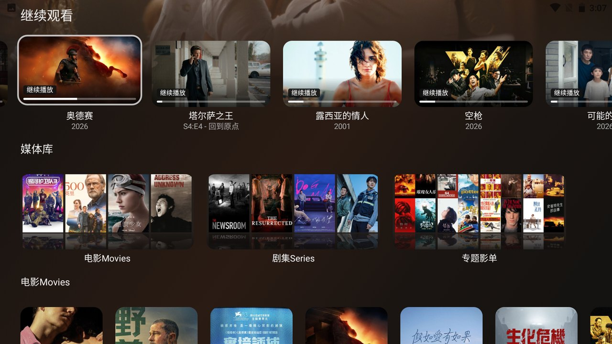
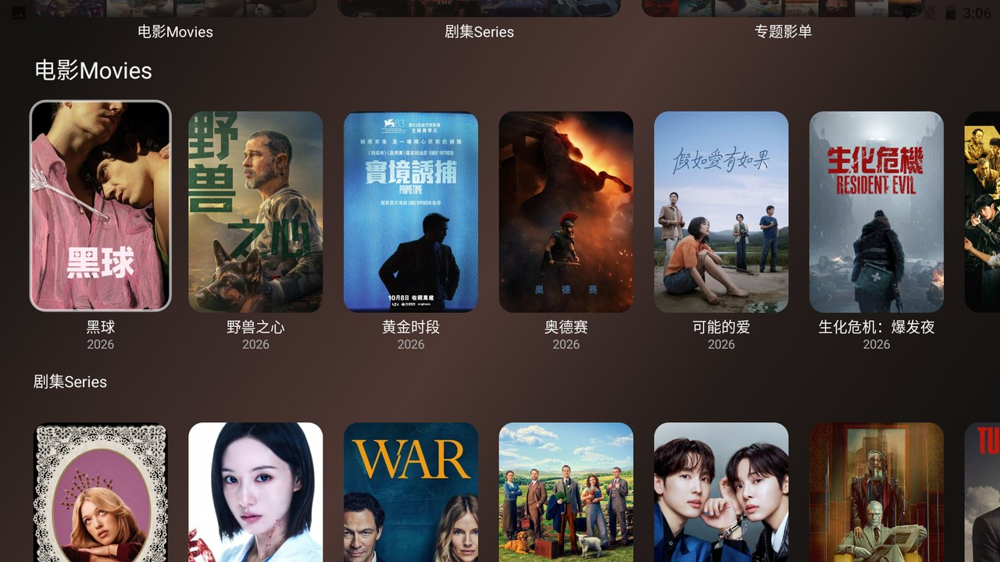
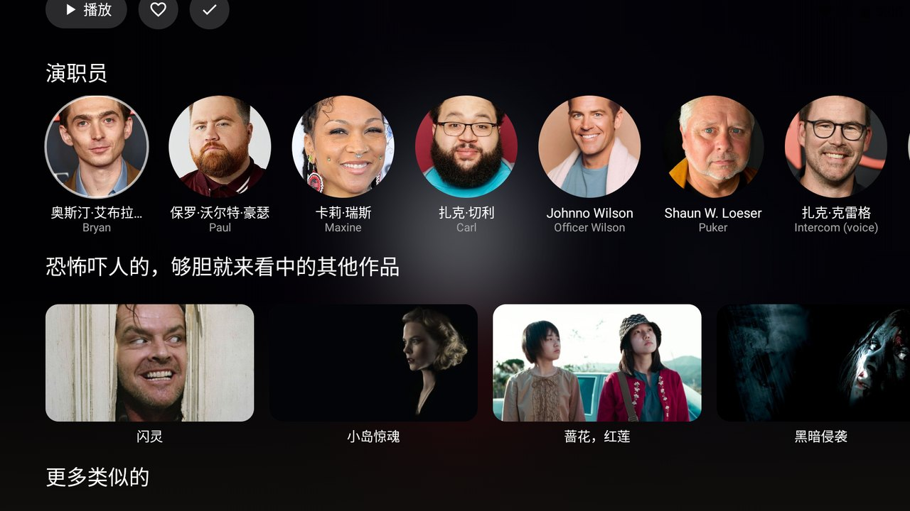

# 🎬 Verge

<div align="center">

**Verge · 开源 Emby TV 客户端 | Open-source Emby Client for TV/Box**

[](https://www.android.com)
[](https://github.com/fennyshi-creator/verge-tv/releases/)
[](https://creativecommons.org/licenses/by-nc/4.0/)
[](https://github.com/fennyshi-creator/verge-tv/releases/latest)

[简体中文](#简介--introduction) · [English](#introduction)

---

</div>

## ✨ 简介 / Introduction

> 这是一个用于学习和技术交流的开源 Emby 客户端（TV / 盒子向界面）。

本项目主要用于学习 Android 在 TV / 遥控交互、焦点管理，以及与 Emby API 的流式播放集成。

**🛡️ 隐私安全**：App 不收集任何个人信息。只主动访问了 [GitHub Releases API](https://api.github.com/repos/fennyshi-creator/verge-tv/releases/latest) 用于下载更新，其他数据接口为用户自己填写的服务器地址。

> An open-source Emby client aimed at learning and exchanging technical knowledge. This project demonstrates Android usage for TV/remote UI, focus handling, and streaming integration with the Emby API.

**🛡️ Privacy & Security**: The app does not collect any personal information. It only accesses the GitHub Releases API to download updates. All other data connections are user-configured server addresses.

---

## 📥 下载 / Download

> 最新版本 / Newest release: v1.0.5

| 最低 Android 版本 | 下载地址 |
|:------------------:|:--------:|
| Android 6.0+ | [GitHub Releases](https://github.com/fennyshi-creator/verge-tv/releases/) |

---

## ⭐ 特性 / Features

| # | 功能特性 | Feature |
|:-:|:--------|:--------|
| 🔐 | 电视扫码登录，手机录入后电视自动开登 | Scan a QR code on the TV and finish login from a phone |
| 🎮 | 专为 Android TV / 遥控器设计的焦点与按键交互 | Focus and key handling designed for Android TV remotes |
| 🏠 | 客厅首页：满屏剧照、继续观看、媒体库与最新影片/剧集 | Living-room home: full-bleed stills, continue watching, libraries, and latest titles |
| ❤️ | 独立收藏页，收藏影片与剧集 | Dedicated favorites page for movies and series |
| 🔍 | 搜索影片与剧集 | Search movies and series |
| 📋 | 详情页含演职员、合集、类似作品；支持剧集/季/集与多版本导航 | Details with cast, collections, and similar titles; season, episode, and version navigation |
| 🎬 | 底层播放器采用 [FSPlayer](https://github.com/debugly/fsplayer)（ijkplayer 的后续维护版），支持直链 / HLS / fMP4 流媒体播放 | Player built on [FSPlayer](https://github.com/debugly/fsplayer) (the maintained ijkplayer successor) for URL, HLS, and fMP4 streaming |
| 🔊 | URL 流媒体音频比特流透传：当 HDMI / 功放支持时，将 AC-3、E-AC-3 及杜比全景声（E-AC-3 JOC）原样送出，不做先解码再重编码；不支持透传时回退到本地 FFmpeg 解码，可选立体声 | Bitstream passthrough of AC-3, E-AC-3, and Dolby Atmos (E-AC-3 JOC) to a capable HDMI/AVR sink, without decode-and-re-encode; falls back to local FFmpeg decode with optional stereo downmix |
| 📺 | 硬解 4K HDR / 杜比视界；硬解或直通失败时自动走服务器转码 | Hardware decoding of 4K HDR and Dolby Vision, with server transcode fallback |
| 🌈 | SDR 电视可手动开启 HDR-SDR 映射（优先硬解映射）；详情页显示 HDR 标识 | Optional HDR-SDR tone mapping on SDR displays (hardware map preferred); HDR badge on the details page |
| ⚙️ | 播放设置（解码偏好、立体声、HDR-SDR、跳过片头、缓冲等）保存在本机，下次自动生效 | Playback settings (decoder preference, stereo, HDR-SDR, skip intro, buffer, and more) persist on the device |
| ⏭️ | 支持跳过片头 | Skip opening credits / intros |
| 💾 | 支持缓冲设置 | Buffer settings |
| 🌐 | 支持配置 HTTP / SOCKS5 代理（仅代理 Emby 服务） | HTTP/SOCKS5 proxy support (Emby service only) |

> **本地 FFmpeg 可解码的音频格式**: `flac`, `alac`, `pcm_mulaw`, `pcm_alaw`, `mp3`, `aac`, `ac3`, `eac3`, `dca`, `mlp`, `truehd`  
> TrueHD 目前为本地解码，不作为比特流透传能力宣传。本地文件播放未作为本项目的已验证能力。

---

## 📱 展示 / Screenshots

### 首页 / Home


### 继续观看与媒体库 / Continue watching and libraries


### 媒体库 / Library


### 详情页 / Details


### 演职员、合集与类似作品 / Cast, collections, and similar


---

## 🎯 播放流程 / Playback Flow

```
用户点击播放 → 调用播放信息接口 → 设置播放器 → 开始播放
User clicks play → Call playback info API → Setup player → Start playback
```

播放开始后会注册会话并定期上报进度。直通或硬解失败时，客户端会自动回退到服务器转码并重试。

After playback starts, the client registers a session and reports progress periodically. If direct play or hardware decode fails, it automatically falls back to server transcoding and retries.

---

## 🔗 外部服务 / External Services

| 接口 / API | 用途 / Purpose |
|:----|:----|
| `GET https://api.github.com/repos/fennyshi-creator/verge-tv/releases/latest` | 获取最新版本信息 / Get latest version info |

---

## 🤝 贡献与交流 / Contributing

欢迎通过 Issues 或 PR 交流问题与改进想法！
Feel free to open Issues or PRs to discuss problems or suggest improvements.

> This project is primarily for learning and technical exchange.

---

## 📜 许可与致谢 / License and Acknowledgments

<a rel="license" href="https://creativecommons.org/licenses/by-nc/4.0/"></a>

本项目采用 **Creative Commons Attribution-NonCommercial 4.0 International (CC BY-NC 4.0)** 许可，完整文本见仓库根目录 [`LICENSE`](./LICENSE)。

Verge 在开源项目 [OpenEmby TV](https://github.com/shareven/openemby_tv)（作者 [shareven](https://github.com/shareven)，同样为 CC BY-NC 4.0）的源码基础上修改而来，包括界面、播放和客厅交互等方面的改动。按该许可，使用、分发或再修改时需保留署名、注明原作及修改，并禁止用于商业用途。

**SPDX-License-Identifier:** `CC-BY-NC-4.0`

| 允许 / Allowed | 禁止 / Not Allowed |
|:----|:----:|
| ✅ 复制和分发 / Copy and distribute | ❌ 商业用途 / Commercial use |
| ✅ 改编和改造 / Adapt and remix | |
| ✅ 注明作者和来源 / Attribution required | |

**许可证原文 / License text:** [CC BY-NC 4.0](https://creativecommons.org/licenses/by-nc/4.0/legalcode)

### 第三方组件 / Third-party

播放器内核基于 [FSPlayer](https://github.com/debugly/fsplayer)（ijkplayer 的后续维护版，当前采用 1.1.2），采用 **GNU Lesser General Public License v2.1 or later**。对应源码与 `COPYING.LGPLv2.1` 位于 [`third_party/fsplayer/`](./third_party/fsplayer/)。该组件中包含的 FFmpeg 仍遵循其自身的 LGPL 条款；应用其余部分仍为 CC BY-NC 4.0。

---

<div align="center">

**如果这个项目对你有帮助，欢迎 ⭐ Star**
**If this project is helpful to you, please ⭐ Star**

</div>
